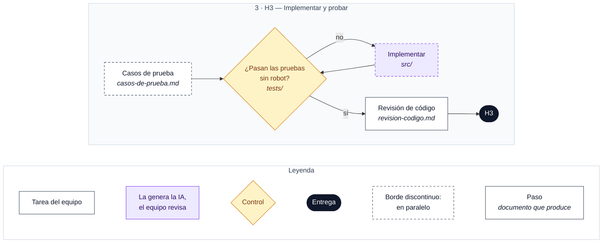

# H3 · Implementación y pruebas

**Entregable:** código ejecutable y pruebas en el repositorio.

**Mínimo exigido:** implementación generada con apoyo de IA, revisión del código y **pruebas reproducibles sin necesidad del robot físico**.

**Reparto del trabajo:** [`reparto-modulos.md`](reparto-modulos.md) (interfaz, intérprete, órdenes y robot, y bloque común). **Estado de cada requisito:** [`plan-pruebas.md`](plan-pruebas.md).

## Cómo instalar y ejecutar

> Parcial (T058): sin voz real (falta P-01) y para un solo portátil (P-07 sin decidir). La interfaz es una página web local (D-07); P-06 sigue pendiente de confirmar por el equipo.

**Requisitos**: Python 3.12 (probado con 3.12.10) en el portátil. No hace falta internet ni el robot.

1. Instalar las dependencias (una vez), desde esta carpeta (`H3-implementacion-pruebas/`):
   ```
   python -m pip install -r requirements.txt
   ```
2. Pasar las pruebas (no usan robot, micrófono ni red; solo `127.0.0.1` en las del servidor):
   ```
   python -m pytest
   ```
3. Arrancar el programa con el robot simulado, desde `H3-implementacion-pruebas/src/`:
   ```
   cd src
   python -m atenio --simulado
   ```
   Se abre el navegador en `http://127.0.0.1:8642/`. Para salir: `Ctrl+C` en la terminal.
4. Probarlo en la página:
   - Escribir `Atenio, siéntate` en la caja y pulsar **Enviar**: aparece el texto, la orden (`siéntate (REQ-02)`) y el comando `ksit` en «Comandos enviados al robot».
   - `Atenio, vuela` → aviso «orden no disponible: «vuela»». `hola` (sin «Atenio») → no pasa nada (REQ-01).
   - Pulsar **PARADA DE EMERGENCIA**: el botón cambia a «PARADA ACTIVA», se envía `d` y las órdenes se bloquean. Otro clic desbloquea (REQ-30).

**Opciones de `python -m atenio`**

| Opción | Qué hace |
|---|---|
| `--simulado` | Robot simulado (lo que dice `datos/ajustes.json`, clave `enlace`, si no se pone nada). |
| `--serie` | Robot real por el puerto serie de `ajustes.json` (`puerto`, `baudios`). Hoy `puerto` es `null` (OPEN-07): la página muestra «Robot no conectado». |
| `--voz` | Escucha el micrófono con `atenio.escucha` (bloque B). Si el módulo no está, avisa y sigue sin voz. |
| `--puerto N` | Puerto de la página (por defecto 8642). Si está ocupado, el programa lo dice y sale. |
| `--sin-navegador` | No abre el navegador. |

## Flujo de trabajo

Cada caja indica en cursiva el documento que produce. Leyenda debajo del diagrama.



### Pasos

**A la vez:**
- [ ] Diseñar los casos de prueba → `casos-de-prueba.md`
- [ ] Implementar el primer incremento con IA (`/speckit.implement`) → `src/`

**Después:**
- [ ] Pruebas reproducibles sin el robot → `tests/`. Si fallan, se vuelve a implementar.
- [ ] Revisión del código → `revision-codigo.md`

> La ubicación exacta de `src/` y `tests/` se fija en `plan.md`.

> El detalle de este hito se completará cuando se presente en clase.
