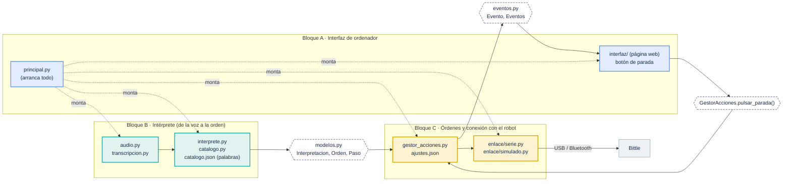

# H3 · Reparto del trabajo por bloques

**Fecha**: 04/11/2026 · **Fuentes**: [`tasks.md`](../H2-especificacion-planificacion/tasks.md) (84 tareas), [`plan-pruebas.md`](plan-pruebas.md) (estado de cada REQ), [`plan.md`](../H2-especificacion-planificacion/plan.md) (arquitectura), [`discrepancias.md`](../H2-especificacion-planificacion/discrepancias.md).

Este documento reparte **todo lo que falta** en tres bloques del sistema que se pueden hacer en paralelo, más un bloque común. Cada tarea lleva su número de `tasks.md`; el detalle de cada una (REQ, base, resultado esperado) está allí. Se ponen las iniciales en «Responsable» y se marca la casilla al terminar.

## Dónde está el plan

| Qué | Archivo |
|---|---|
| Reglas fijas del proyecto | [`H2-especificacion-planificacion/constitution.md`](../H2-especificacion-planificacion/constitution.md) |
| Requisitos y escenarios | [`H1-especificacion-inicial/Entregable-H1.md`](../H1-especificacion-inicial/Entregable-H1.md), [`H2-especificacion-planificacion/spec.md`](../H2-especificacion-planificacion/spec.md) |
| Arquitectura y decisiones D-01 a D-14 | [`H2-especificacion-planificacion/plan.md`](../H2-especificacion-planificacion/plan.md) |
| Las 84 tareas y su estado | [`H2-especificacion-planificacion/tasks.md`](../H2-especificacion-planificacion/tasks.md) |
| Coherencia entre spec, plan y tasks | [`H2-especificacion-planificacion/coherencia.md`](../H2-especificacion-planificacion/coherencia.md) |
| Lo que decide el equipo | [`H2-especificacion-planificacion/discrepancias.md`](../H2-especificacion-planificacion/discrepancias.md) y «Decisiones pendientes» de `plan.md` (P-01 a P-10) |
| Cada REQ → su prueba → estado | [`H3-implementacion-pruebas/plan-pruebas.md`](plan-pruebas.md) |
| Resumen para presentar | [`H2-especificacion-planificacion/presentacion-plan.html`](../H2-especificacion-planificacion/presentacion-plan.html) (abrir en el navegador) |
| **Este reparto** | `H3-implementacion-pruebas/reparto-modulos.md` |

## Los bloques y lo que comparten

**Contratos** (las cajas con borde discontinuo): son el punto de unión entre bloques. Ya existen en `main` y tienen pruebas. **Un bloque no cambia un contrato sin avisar a los otros dos**; si hace falta, se cambia en un commit aparte y se avisa en el grupo.

| Contrato | Archivo | Lo produce | Lo usa |
|---|---|---|---|
| `Interpretacion` (tipo, órdenes, avisos), `Orden`, `Paso` | `src/atenio/modelos.py` | B | C |
| `Evento`, `TipoEvento`, `Eventos.publicar()` / `suscribir()` | `src/atenio/eventos.py` | C (y B para «texto reconocido») | A |
| `GestorAcciones.pulsar_parada()` | `src/atenio/gestor_acciones.py` | C | A (botón) |
| `Enlace` (conectar, enviar, leer líneas) | `src/atenio/enlace/base.py` | C | C, A (`principal.py` elige real o simulado) |

**Cómo trabajar en paralelo**: cada bloque en su rama (`h3/interfaz`, `h3/interprete`, `h3/robot`). Antes de abrir el PR: `python -m pytest` en `H3-implementacion-pruebas/` en verde. Cada uno toca solo los archivos de su bloque (columna «Archivos» abajo).

---

## Bloque A · Interfaz de ordenador

**Qué es**: lo que ve y toca el usuario en el portátil, y el programa que arranca todo. **Archivos**: `src/atenio/interfaz/`, `src/atenio/principal.py`, sección de instalación del `README.md` de H3. **No necesita robot ni micrófono**: funciona con el robot simulado.

**Responsable**: ____

| ☐ | Tarea | Qué hay que hacer | Depende de |
|---|---|---|---|
| ☐ | T019, T045 | `principal.py`: monta intérprete → gestor → enlace (real o simulado según `ajustes.json`). La clase `Cadena` de `tests/integracion/test_cadena.py` sirve de modelo. | — (se puede empezar ya) |
| ☐ | T009 | `tests/unitarias/test_eventos.py`: los cuatro tipos de evento (texto reconocido, orden interpretada, estado de conexión, aviso). `eventos.py` ya existe. | — |
| ☐ | T055 | `tests/integracion/test_eventos_interfaz.py`: un receptor de eventos recibe texto, orden, estado y aviso para una frase válida y una inválida. Incluye publicar el estado de conexión al conectar (hallazgo U2 de `coherencia.md`). | T009 |
| ☐ | T056 | `src/atenio/interfaz/`: página web local con texto reconocido, orden, estado de conexión, avisos y **botón de parada** conectado a `pulsar_parada()`. | **P-06** (web o escritorio; el plan propone web, D-07) |
| ☐ | T057 | `principal.py` completo: micrófono → transcripción → intérprete → gestor → enlace → interfaz. | T019, bloque B (voz), **P-07** |
| ☐ | T058 | «Cómo instalar y ejecutar» en el `README.md` de H3. Prueba: alguien que no escribió el código lo arranca solo con esa sección. | T057, **P-07** («otro ordenador») |

**Decisiones del equipo que necesita**: P-06 (tipo de interfaz), P-07 (¿un portátil o dos?).

---

## Bloque B · Intérprete (de la voz a la orden)

**Qué es**: todo lo que pasa desde que el usuario habla hasta que hay una orden: micrófono, transcripción, «Atenio», catálogo de palabras, órdenes encadenadas. **Archivos**: `src/atenio/audio.py`, `transcripcion.py`, `interprete.py`, `catalogo.py`, `datos/catalogo.json` (palabras y sinónimos), `tests/frases/`, `prototipos/motor-voz/`.

**Responsable**: ____ (voz: Mario)

| ☐ | Tarea | Qué hay que hacer | Depende de |
|---|---|---|---|
| ☐ | T047, T048 | Prototipo de voz: medir Vosk y Faster-Whisper con 27 frases (latencia, aciertos, si oye «Atenio»; sin audio en disco). **El script ya está hecho** en la rama `h3/perro-voz`: `prototipos/motor-voz/medir.py --mic`. Falta decir las frases y anotar el resultado. | — |
| ☐ | — | **Elegir el motor de voz** con esa medida. | **P-01** (equipo) |
| ☐ | T049, T050, T051 | `audio.py` y `transcripcion.py` con el motor elegido, y sus pruebas con motor falso (`test_transcripcion.py`, `test_sin_audio_en_disco.py`). **Ya hechos** en `h3/perro-voz` para los dos motores; falta fusionarlos tras P-01. | P-01 |
| ☐ | T052, T053, T054 | Con voz real y robot simulado: 20 medidas de latencia (< 1,5 s), 20 intentos por orden (≥ 80 %), comprobar que no queda audio en disco. Se anota en `casos-de-prueba.md`. | T050, T051 |
| ☐ | T020 | `tests/integracion/test_latencia_software.py`: 20 medidas con reloj real desde el texto hasta el registro del simulado, todas < 1,5 s. | — (se puede empezar ya) |
| ☐ | T010, T011 (revisión) | **Revisar los sinónimos de `catalogo.json` y las frases de `tests/frases/`**: los escribió la IA y el reto pide que los escriba o revise el equipo. | — (equipo) |
| ☐ | T021, T022, T024 | Distinguir «no entendida», «fuera del catálogo» e «ignorada», con sus avisos. El código y las pruebas ya existen con una regla provisional. | **Y-02, Y-04** |
| ☐ | T028, T030, T031 | Órdenes encadenadas: máximo por frase y palabras de enlace. Código hecho, valores provisionales. | **P-03** |
| ☐ | T035, T038 (parte del intérprete) | «para» dentro de una frase encadenada («camina y para»): qué se hace con lo que viene detrás. Compartida con el bloque C. | **P-04** |

**Decisiones del equipo que necesita**: P-01 (motor de voz), Y-02 y Y-04 (ruido y frases sin sentido), P-03 (encadenadas), P-04 («para»).

---

## Bloque C · Lógica de órdenes y conexión con el robot

**Qué es**: el gestor de acciones (cola, «para», parada, reposo, sin conexión) y el enlace con el Bittle por USB o Bluetooth, con las sesiones con el robot físico. **Archivos**: `src/atenio/gestor_acciones.py`, `src/atenio/enlace/`, `datos/ajustes.json`, `datos/catalogo.json` (comandos y duraciones), `H4-demostracion-aceptacion/ensayos-fisicos.md`.

**Responsable**: ____ (sesiones con el robot: quien tenga el Bittle)

**Primero, la sesión 2 con el robot** (no depende del código; cierra P-02, P-03, P-05 y P-09). Toda sesión empieza con T068. Hoja para anotar: [`H4-demostracion-aceptacion/ensayos-fisicos.md`](../H4-demostracion-aceptacion/ensayos-fisicos.md). Herramientas para mandar órdenes con un clic y cronometrar: [`verificacion-robot/`](verificacion-robot/README.md) (panel web y consola; no forman parte del programa).

| ☐ | Tarea | Qué hay que hacer | Depende de |
|---|---|---|---|
| ☐ | T068 | Lista de seguridad antes de cada sesión: superficie lisa y una persona vigilando (REQ-28). | — |
| ☐ | T070 | Conectar por USB y por Bluetooth: puerto, baudios, si el emparejamiento funciona, y si cada comando necesita salto de línea. La rama local `h2/bluetooth-oficial` lista los datos oficiales que hay que comprobar. | — |
| ☐ | T069 | **Cronometrar cada orden del Nivel 1** y el tiempo de marcha de `kwkF`, `kwkL`, `kwkR`, `ktrF`; anotar qué devuelve el robot. **Es lo más urgente**: sin estas duraciones, una orden en cola no termina sola. | — |
| ☐ | T071 | Probar `khi`, `ktrF`, `krest` y `d`, y si `lifted`/`dropped` paran el robot. Lista real de skills con `printSkillFileName()`. | — |
| ☐ | T080 | Secuencia de «baila», duración de «media vuelta» y «da una vuelta», y qué comando corta el giro. | — |

**Después, con las medidas:**

| ☐ | Tarea | Qué hay que hacer | Depende de |
|---|---|---|---|
| ☐ | T033 | Poner las duraciones medidas en `catalogo.json` (hoy solo `ksit` = 2 s). | T069 |
| ☐ | T046, T044 | Puerto, baudios y fin de línea medidos en `ajustes.json`; cerrar `enlace/serie.py`. | T070, **P-02** |
| ☐ | T029, T032 | Cola con las duraciones reales. Código hecho. | T033, **P-03** |
| ☐ | T036, T039 | Parada de emergencia: ¿`d` o `krest`? Código hecho con `d`. | **P-05, Y-03** |
| ☐ | T062, T063 | Reposo por inactividad (T = 5 min demo / 15 min uso real). Código hecho. | **P-05** |
| ☐ | T035, T038 (parte del gestor) | «para» vacía la cola o no. Código hecho con «vacía» (ajuste). | **P-04** |
| ☐ | T061 | Pérdida de conexión durante una acción. Código hecho. | **P-08** |
| ☐ | T060 | Publicar el estado de conexión como evento (para la interfaz). **Hecho en la rama `H3-moduloC`**: `GestorAcciones.conectar()`, `publicar_estado_conexion()` y `tick()` publican `conectado`/`desconectado` (`test_gestor_estado_conexion.py`). Se cierra cuando la interfaz (T056) lo muestre. | — |
| ☐ | T065 | Nunca enviar `G` ni `g` (giroscopio). Código hecho. | **Y-01** |
| ☐ | T066, T067 | Órdenes opcionales: «baila», «media vuelta», «da una vuelta». | T080, **P-09**, X-07 |
| ☐ | T072 a T079, T081 | Pruebas con el robot real y el programa completo (H4): cada orden, parada, encadenadas, desconexión, reposo, batería baja, levantarlo, giros. | T057 (bloque A), P-02 |

**Decisiones del equipo que necesita**: P-02 (USB o Bluetooth), P-03 (duraciones), P-04, P-05 y Y-03 (comando de reposo), P-08, P-09, Y-01, X-07.

---

## Bloque común (todo el equipo)

| ☐ | Tarea | Qué hay que hacer | Responsable |
|---|---|---|---|
| ☐ | Discrepancias | Responder las 13 abiertas de `discrepancias.md` (Y-02, Y-04, Y-03, X-06, X-07, X-01 a X-05, Y-01, Y-05, Y-06) y P-01 a P-10. Desbloquean 26 tareas que ya tienen código. | todos |
| ☐ | T001 | Confirmar P-10: Python, estructura de carpetas, catálogo en fichero, reloj sustituible, pruebas por texto. Ya se usa así en el código. | todos |
| ☐ | T012, T026 | Guardián en `tests/conftest.py`: falla cualquier prueba que abra un puerto serie o el micrófono. | ____ |
| ☐ | T027 | Script que ejecuta las pruebas dos veces y compara (SC-007). | ____ |
| ☐ | T004, T041, T083 | `casos-de-prueba.md`: un caso por REQ con su nivel y su resultado (`plan-pruebas.md` sirve de base). **Entregable de H3.** | ____ |
| ☐ | T042, T082 | Revisión del código por el equipo → `revision-codigo.md`. **Entregable de H3.** | ____ |
| ☐ | T084 | Revisar `coherencia.md` (2 hallazgos graves: SC-001 bloqueado y P-07). | ____ |
| ☐ | H2 | Etiquetar H2 en Git y entregar el enlace del repositorio. | ____ |
| ☐ | T074 | Ensayo general de la demo (SC-001): voz real, interfaz y robot real. | todos, al final |

## Orden recomendado

1. **Ya, en paralelo**: A (T019, T009, T055), B (T047 medida de voz, T020, revisión de sinónimos y frases), C (sesión 2: T068, T070, T069, T071, T080), común (T012, T026, T027, T004).
2. **Reunión de decisiones**: discrepancias y P-01 a P-10 con los datos de la sesión 2 y de la medida de voz.
3. **Cerrar con las decisiones**: B (motor de voz), C (duraciones, parada, reposo), A (interfaz y `principal.py` completo).
4. **H4**: pruebas con el robot real (T072 a T081) y ensayo de la demo (T074).
